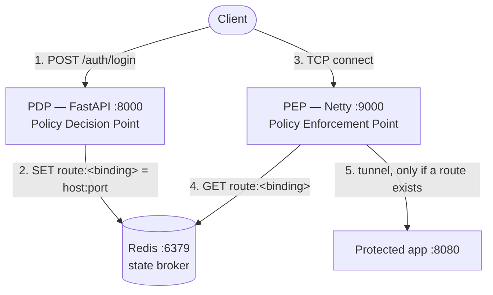

# AegisX architecture

## The picture



Same diagram in plain text (for terminals and READMEs):

```
Client ──1. POST /auth/login──▶ PDP (FastAPI :8000, Policy Decision Point)
                                    │ 2. SET route:<binding> = host:port
                                    ▼
                               Redis :6379 (state broker)
                                    ▲
Client ──3. TCP connect──────▶ PEP (Netty :9000, Policy Enforcement Point)
                                    │ 4. GET route:<binding> (re-read every 5 s)
                                    ▼
                               Protected app :8080 (only if a route exists)

No arrow runs PDP → PEP: the PDP never calls the PEP. Redis is the only
link between the planes.
```

## The 60-second data flow

**Login.** The client POSTs a username and password to the PDP (`:8000`).
The PDP first checks emergency lockdown (on → 403, before credentials are
even looked at), then checks the password against the Redis user directory,
checks the policy — is this identity entitled to that app, does the device
posture pass, is the certificate identity (if any) the one registered to
this user *and not revoked*, is the app usable right now (time window) —
and, only if everything passes, mints a JWT and writes one record into
Redis: `route:<binding> = host:port`, with the TTL from that app's policy
record (default 3600 s). The binding is the
certificate's Common Name (`device:alice`) when a certificate is involved,
otherwise the source address the login came from. The policy the login is
judged by is the live one from Redis, loaded once per login (see
"Policy-as-data" below) — never a stale copy.

**Policy-as-data.** Application policy is data, not code: one JSON record
per app in the Redis hash `policy:apps`
(`{target, posture, allowed_hours, session_ttl_seconds, enabled}`).
`APP_TARGETS` / `POSTURE_RULES` in `identity.py` are only the seed defaults
a fresh install starts from, and a `policy:seeded` marker stops the seed
from resurrecting an app an admin deleted. The flow:

```mermaid
flowchart LR
    Admin([Admin]) -->|PUT /admin/policy/{app}| PDP[PDP]
    PDP -->|HSET policy:apps| Redis[(Redis)]
    PDP -->|invalidate_policy_cache| Cache[(5 s in-memory cache)]
    Cache -.->|next login re-reads Redis| PDP
```

An admin PUT writes the record, invalidates the PDP's 5-second in-memory
cache, and audits the change — the very next login is judged by the new
rules, with no restart. The cache exists only so a login storm does not hit
Redis for the policy on every login; the 5 s TTL is a backstop for edits
made outside the API. The PEP never reads policy: it only ever sees the
route the PDP wrote, so policy changes need no PEP reload.

**Lockdown.** Emergency lockdown is one Redis key, `admin:lockdown`
(present = on, absent = off). Flipping it on does two things at once:
`POST /admin/lockdown` sets the flag *and* revokes every live session
through the normal revoke path, so open tunnels die at the next PEP
revalidation (at most 5 s later) instead of lingering until their TTL.
While the flag is on, every login — password and service-key alike — is
refused with 403 before credentials are checked. The dashboard shows a
banner when `/dashboard/state` reports `lockdown: true`; the flag lives in
the FULL view of that feed, so with `AEGISX_DASHBOARD_AUTH=1` and no admin
token the banner will not show.

**Route.** That Redis record is the entire authorization. There is no call
from the PDP to the PEP and no config file to reload — the record existing
*is* the permission.

**Tunnel.** The client then opens a TCP connection to the PEP (`:9000`). The
PEP looks up `route:<binding>` in Redis (async, via Lettuce, so no Netty
EventLoop thread ever blocks). No record → the connection is closed with no
payload at all: the gateway looks like a closed port (cloaking). Record →
the PEP opens a micro-tunnel to exactly that one `host:port` and forwards
bytes. While the tunnel is open the PEP re-reads the route every 5 s
(`AEGISX_REVALIDATE_SECONDS`).

**Revoke.** Logout, admin force-revoke, or TTL expiry deletes the route and
denylists the JWT's `jti` in one atomic Lua script. The next revalidation
— at most 5 s later — closes tunnels that are already open, not just future
connections. The token itself is dead immediately: `/auth/verify` answers 401.

## Ports and environment

| Port | Service | Source of the default |
|---|---|---|
| 8000 | PDP (FastAPI) | `scripts/demo_e2e.sh` (`CP_PORT`) |
| 9000 | PEP (Netty) | `AEGISX_PEP_PORT` in `ZtnaProxyServer.java` |
| 8080 | Protected app `internal-api` | seed default in `identity.py` (live policy in Redis `policy:apps`) |
| 9090 | Protected app `metrics-dashboard` | seed default in `identity.py` (live policy in Redis `policy:apps`) |
| 6379 | Redis | `AEGISX_REDIS_URL` in `config.py` |

Key environment variables (all defaults live in `control-plane/app/config.py`
and `ZtnaProxyServer.java`): `AEGISX_REDIS_URL`, `AEGISX_JWT_SECRET`,
`AEGISX_TOKEN_TTL` (3600), `AEGISX_ROUTE_TTL` (3600),
`AEGISX_LOGIN_RATE_LIMIT` (5) / `AEGISX_LOGIN_RATE_WINDOW` (60),
`AEGISX_LOGIN_IP_RATE_LIMIT` (30), `AEGISX_LOGIN_FAIL_MAX` (5),
`AEGISX_LOCKOUT_SECONDS` (300), `AEGISX_POSTURE_STRICT` (0),
`AEGISX_PEP_PROBE_ADDR` (`127.0.0.1:9000`), `AEGISX_PEP_PORT` (9000),
`AEGISX_REVALIDATE_SECONDS` (5), `AEGISX_MTLS` + `AEGISX_MTLS_CERT` /
`AEGISX_MTLS_KEY` / `AEGISX_MTLS_CA`, `AEGISX_TRUST_PROXY` (0),
`AEGISX_POLICY_CACHE_SECONDS` (5), `AEGISX_DASHBOARD_AUTH` (0),
`AEGISX_TLS` (0), `AEGISX_PEP_REQUIRE_READY` (0) +
`AEGISX_PDP_URL` (`http://127.0.0.1:8000`).

**Client identity rule.** A login is bound to the socket's real peer address.
The `client_ip` field in the login body is ignored by default; only behind a
trusted reverse proxy (`AEGISX_TRUST_PROXY=1`) is the first entry of
`X-Forwarded-For` believed instead (`routes_auth.py: resolve_client_ip`).
With mTLS the binding is the certificate CN and the address is irrelevant.

**Health vs readiness.** `/health` answers `{"status": "ok"}` after a Redis
ping. `/ready` answers 200 `{"status": "ready"}` only when Redis pings OK
*and* at least one `users:*` record exists (the directory is seeded); otherwise
503 `{"status": "not_ready", "detail": ...}` (`routes_health.py`).
With `AEGISX_PEP_REQUIRE_READY=1` the PEP polls `/ready` before binding and
exits without listening if the PDP never reports ready
(`ZtnaProxyServer.requireControlPlaneReady`; live-unverified — Java TCP is
blocked in the build VM).

## Redis key schema

Verified against `control-plane/app/state.py` and `identity.py`.

| Key | Value | Written by | Lifetime |
|---|---|---|---|
| `route:<binding>` | `"host:port"` of the one authorized tunnel | PDP login gate | per-app `session_ttl_seconds` (default 3600 s) |
| `sess:<binding>` | hash `{user, role, app, target, jti, client_ip, device}` — the PDP's view of the live session | PDP | same as the route |
| `users:<name>` | hash `{password_hash, role, apps, device, disabled?, created_at}` — the user directory | seeded at startup; admin user API | none |
| `policy:apps` | hash `{app name: JSON policy record}` — the live policy | seeded at first use; admin policy API | none |
| `policy:seeded` | `"1"` — marker so the seed never resurrects a deleted app | PDP seed | none |
| `cert:deny:<CN>` | `"1"` — revoked device certificate | admin device revoke | 24 h |
| `admin:lockdown` | `"1"` while emergency lockdown is on (absent = off) | admin lockdown API | none (deleted on switch-off) |
| `svc:<name>` | hash `{key_hash, app}` — service account (key shown once, only SHA-256 stored) | admin service-account API | none |
| `jwt:deny:<jti>` | `"1"` — revoked token | PDP logout / admin revoke | token's remaining `exp` |
| `login:rl:<user>` | per-user login-attempt counter | login gate | 60 s window |
| `ipl:<client_ip>` | per-source-IP login-attempt counter | login gate | 60 s window |
| `fails:<user>` | consecutive failed logins (drives lockout) | login gate | 300 s |
| `lock:<user>` | `"1"` — account locked | login gate | 300 s |
| `audit:events` | Redis Stream: every allow/deny/login/logout/admin action | both planes | capped at 10,000 entries |
| `pep:allow`, `pep:deny`, `pep:active`, `pep:closed`, `pep:revoked` | enforcement counters | PEP | none |
| `logins:ok`, `logins:denied`, `admin:revocations` | PDP counters | PDP | none |

`<binding>` is `device:<cert CN>` for certificate-bound sessions, otherwise
the source address (`state.binding`).

## The two Lua scripts

Both live in `control-plane/app/state.py`. They exist so concurrent control
planes can never interleave a login against a logout — no distributed locks.

- **`LOGIN_LUA` (login gate):** lockout check + per-user and per-IP rate
  accounting + failure-streak tracking + route provisioning, in one atomic step.
- **`LOGOUT_LUA` (revocation):** denylist the token's `jti` + delete the
  route + delete the session record, in one atomic step — the PEP can never
  see a half-revoked session.

## Honest limitations

- **Demo PKI.** `certs/` is throwaway material from `scripts/gen_certs.sh`;
  `ca.key` sits in the clear and must never leave a test machine.
  Certificate enrollment (`scripts/enroll_device.sh`,
  `POST /admin/devices`) and revocation (`POST /admin/devices/revoke`,
  `cert:deny:<CN>`) exist now, but the revocation entry expires after
  24 h — a demo CRL, not a real one — and the PEP-side check is
  live-unverified (Java TCP is blocked in the build VM).
- **Key custody is the trust anchor.** Whoever can read a client's private key
  can act as that identity. The demo keys live unencrypted in `certs/`.
- **`/dashboard/state` is unauthenticated by default**, so the explainer page
  works with no setup. `AEGISX_DASHBOARD_AUTH=1` redacts the sensitive fields
  unless the request carries an admin token; it must sit behind admin auth in
  any real deployment. (`/admin/*` already requires
  an admin-role token.)
- **Single Redis is a single point of failure.** The PEP fails closed, so a
  state-store outage means a global lockout rather than a breach — but it is
  still a lockout. Production uses Sentinel/Cluster.
- **Revalidation is polling** (default 5 s), so a revoked tunnel can live up
  to one interval after revocation. A Redis pub/sub revocation bus would cut
  that to milliseconds.
- **Localhost demo topology.** Everything collapses onto one IP locally (and,
  in Docker, onto the Docker gateway IP for host-originated clients). mTLS
  device binding is what separates identities sharing an address.
- **JWT secret defaults to a dev value** (`AEGISX_JWT_SECRET` must be
  overridden in any non-local deployment).
- **The Redis user directory replaces a real IdP.** The seam is one function
  (`identity.verify_credentials`) — swap it for an OIDC call and the rest of
  the pipeline is unchanged.
- **L4 only.** The PEP forwards bytes; it does not inspect protocols, so a
  tunnel to `internal-api` could carry any protocol that fits the port.
